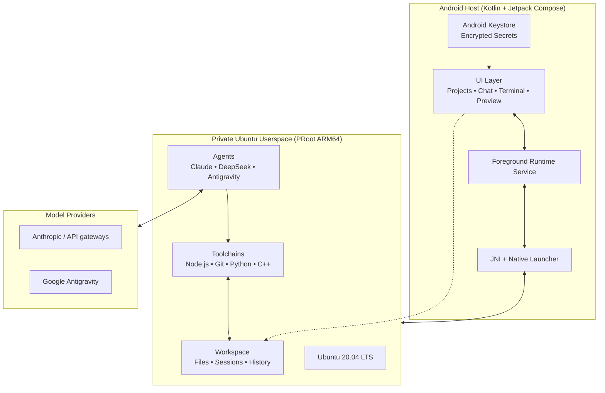

<div align="center">


# Mobile Harness

### AI coding for Android, built for real developers.

**Run Claude Code, edit projects, use a Linux terminal, build apps, and preview web apps directly from your phone — no root required.**

<br />

[](https://github.com/techjarves/Mobile-Harness/releases/latest)
[](#system-requirements)
[](#system-requirements)
[](#)
[](LICENSE)
[](https://youtu.be/QzAau52Z7yQ)

<br />

[**Download APK**](https://github.com/techjarves/Mobile-Harness/releases/latest/download/mobile-harness-online.apk) &nbsp;•&nbsp;
[**Walkthrough**](https://youtu.be/QzAau52Z7yQ) &nbsp;•&nbsp;
[**Quickstart**](#quickstart) &nbsp;•&nbsp;
[**Docs**](docs/README.md) &nbsp;•&nbsp;
[**Architecture**](#architecture) &nbsp;•&nbsp;
[**Build from Source**](#developer-guides)

</div>

---

<p align="center">
  <a href="https://youtu.be/x5T56timmQw" target="_blank" rel="noopener noreferrer">
    
  </a>
  <br />
  <sub>Watch the walkthrough and product demo &nbsp;|&nbsp; <i>Ubuntu, agent tooling, and Android app building from a phone</i></sub>
</p>

---

## Why Mobile Harness?

Mobile Harness turns an Android phone into a compact but capable AI coding workstation.

It gives developers a secure, local, mobile-first workspace for:

- chatting with coding agents
- running real Linux commands
- editing files and projects from a phone
- previewing web apps locally
- building Android apps directly on-device
- working with Claude Code, DeepSeek, and other provider backends

This is not just a chatbot on mobile. It is a portable developer environment designed for coding, iteration, and experimentation anywhere.

> [!IMPORTANT]
> Mobile Harness targets ARM64 Android devices and uses a private userspace PRoot environment for Linux tools. It is designed for developer workflows, not as a general-purpose VM or hardened container runtime.

---

## What makes it different

| Capability | What it enables |
| :--- | :--- |
| AI coding agents | Use local or remote model providers to build, edit, and inspect code |
| Linux terminal | Execute real shell commands inside a private Ubuntu userspace |
| Mobile project workspace | Keep files, chats, sessions, and checkpoints together |
| Web preview | Run local servers and inspect web apps from inside the app |
| Android app workflows | Build, install, and test APKs directly on device |
| Secure secrets handling | Store API keys with Android Keystore-backed encryption |

---

## Quickstart

### 1. Install the app

Download the latest APK from the official GitHub Releases page:

https://github.com/techjarves/Mobile-Harness/releases/latest

Requirements:

- Android 9+
- ARM64 (`arm64-v8a`)
- 4 GB RAM minimum, 8 GB recommended
- Stable network for runtime bootstrap and API access

### 2. Set up the runtime

Launch Mobile Harness and complete the guided setup wizard:

1. Verify system readiness
2. Install required runtimes and toolchains
3. Configure your AI provider or agent
4. Create your first project workspace

### 3. Start building

- Open a project
- Describe the feature or app you want to build
- Let the agent inspect the codebase and propose changes
- Run commands, review diffs, and test locally

---

## Supported providers and agents

Mobile Harness supports Anthropic-compatible APIs and agent integrations such as:

| Provider | Status | Notes |
| :--- | :--- | :--- |
| Anthropic API | Recommended | Native Claude-compatible integration |
| OpenRouter | Supported | Gateway-based model access |
| DeepSeek | Supported | Compatible Anthropic-style endpoint |
| Kimi | Supported | Compatible endpoint support |
| Custom API | Experimental | User-defined endpoint support |

### Agents

| Agent | Authentication | Installation | Notes |
| :--- | :--- | :--- | :--- |
| Claude Code | API key / Claude account | Included in core runtime | Core coding agent workflow |
| DeepSeek Harness | API key | On demand | Flexible AI coding backend |
| Antigravity CLI | Google OAuth / official flow | Downloaded on demand | Alternative agent flow |

---

## Architecture

Mobile Harness bridges native Android UI and Java/Kotlin app logic with a private Linux userspace running under PRoot.



### Core runtime components

- Ubuntu 20.04 ARM64 userspace
- Jetpack Compose mobile frontend
- Native bridge for Linux process execution
- Toolchain support for Node.js, Python, Git, C/C++, Android tooling
- Encrypted credential storage via Android Keystore

---

## Features

### Autonomous agent coding

Native integrations for Claude Code, DeepSeek Harness, and Antigravity CLI enable code generation, file inspection, patching, and execution loops directly on Android.

### Linux toolchain access

Run real Linux commands, package installs, git workflows, local builds, and project automation without depending on external cloud tooling.

### Web app preview

Spin up local servers and preview web interfaces in a controlled in-app environment.

### App building on-device

Build, install, and launch Android projects from the same mobile environment.

### Secure local-first workflow

Sensitive keys and credentials are kept in Android Keystore-backed storage, reducing unnecessary exposure.

---

## Repository structure

```text
Mobile-Harness/
├── app/                    # Android app source
├── assets/                 # App assets and reference media
├── docs/                   # Setup, architecture, roadmap, and guides
├── fastlane/               # Release and metadata automation
├── scripts/                # Runtime bundle preparation tools
├── third_party/             # Third-party source shims and vendored dependencies
├── .github/                # Issue templates and community configuration
├── .gitignore
├── LICENSE
├── PRIVACY.md
├── README.md
├── build.gradle.kts
├── settings.gradle.kts
├── gradlew
├── gradlew.bat
└── mobile-harness-update.json
```

---

## Documentation

- [docs/README.md](docs/README.md) — project docs index
- [docs/ROADMAP.md](docs/ROADMAP.md) — roadmap and feature direction
- [docs/SETUP.md](docs/SETUP.md) — setup and onboarding guide
- [docs/ARCHITECTURE.md](docs/ARCHITECTURE.md) — system design overview

---

## Developer guides

### Build from source

```bash
git clone https://github.com/techjarves/Mobile-Harness.git
cd Mobile-Harness
./gradlew assembleDebug
```

Deploy to a device:

```bash
adb install -r app/build/outputs/apk/debug/app-debug.apk
```

### Run tests and checks

```bash
./gradlew testDebugUnitTest
./gradlew lintDebug
```

### Useful build flags

```bash
./gradlew -PplayBuild=true assembleDebug
./gradlew -PmhNdkVersion=28.2.13676358 assembleDebug
```

---

## Security and privacy

Security is a core part of the project. Please review:

- [SECURITY.md](SECURITY.md)
- [PRIVACY.md](PRIVACY.md)

This project is designed for direct APK distribution and mobile developer use. It is not a VM or container hardening solution, and some runtime limitations apply based on Android system policies.

---

## Contributing

Contributions are welcome. Please read:

- [CONTRIBUTING.md](CONTRIBUTING.md)
- [CODE_OF_CONDUCT.md](CODE_OF_CONDUCT.md)

We are especially interested in:

- bug reports and reproduction steps
- Android-specific runtime fixes
- documentation improvements
- UX improvements for mobile development workflows
- compatibility improvements for newer Android devices

---

## Current limitations

- ARM64-only support
- PRoot is not a full VM or fully hardened container
- Some terminal apps and ncurses interfaces may have display quirks
- Background work is subject to Android battery and process management
- Large builds can be slower on mobile hardware

---

## Legal

- Mobile Harness is an independent open-source project and is not affiliated with Anthropic.
- Claude and Claude Code are trademarks of Anthropic, PBC.
- Ubuntu, Android, Kotlin, Node.js, Git, and other trademarks belong to their respective owners.

---

## License

This project is licensed under the [MIT License](LICENSE).

---

<div align="center">
  <sub>Built for developers who want a serious coding environment wherever they go.</sub>
  <br />
  <sub>Copyright © 2026 Tech Jarves. All rights reserved.</sub>
</div>


