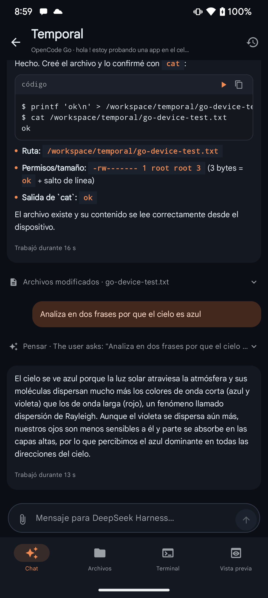
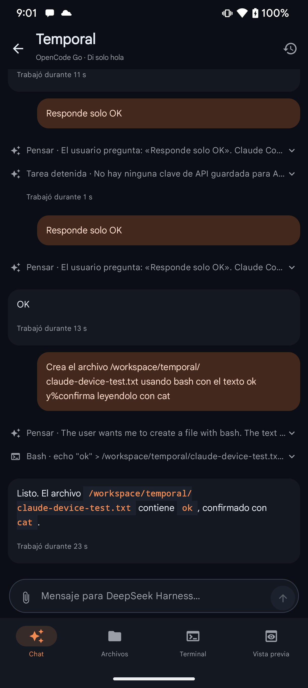
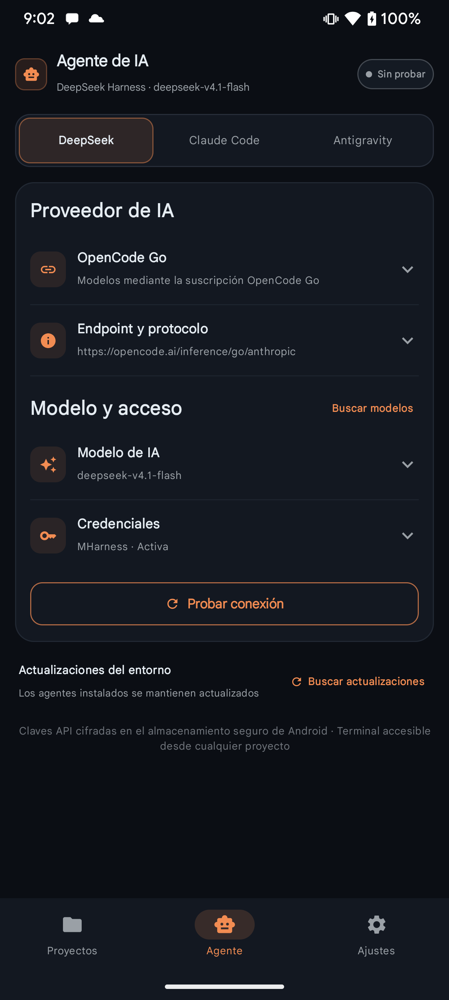
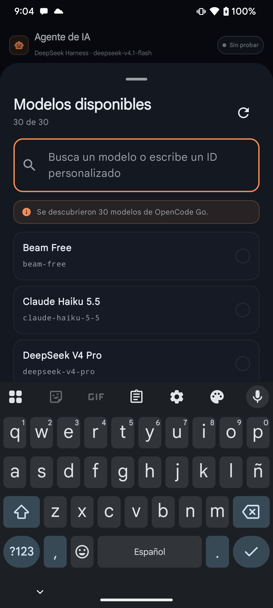
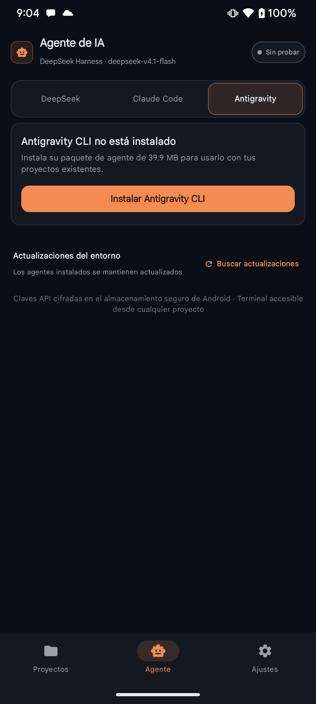

# OpenCode Go — device verification evidence

**Date:** 2026-11-10
**PR:** [#6](https://github.com/hunterhn/Mobile-Harness/pull/6)
**Reviewed code:** `7fa5a82399743fd69b5f3a9720a0f952be9493da`
**Device:** Xiaomi `2312DRA50G` (`garnet`), Android 15
**Build:** `app-online-debug.apk` from the reviewed head, installed with `adb install -r` (same debug signature; app data and saved key preserved)
**Provider:** OpenCode Go · `deepseek-v4.1-flash`

The API key was already in the Android Keystore vault. It was never read,
printed, copied to this document, or committed. No `pocket_secrets.xml` access
was needed.

---

## 1. Result summary

| # | Test | Result | Evidence |
|---|---|---|---|
| 1 | Provider visible for DeepSeek Harness | **PASS** | OpenCode Go row, localized subtitle, fixed endpoint, default model |
| 2 | Provider not offered for Antigravity | **PASS** | Antigravity tab shows only the CLI install prompt |
| 3 | Public model discovery without a key | **PASS** | `30 de 30`; “Se descubrieron 30 modelos de OpenCode Go” |
| 4 | Test connection with the saved Go key | **PASS** | “Conexión con OpenCode Go verificada”; credential active |
| 5a | DSH text | **PASS** | “Responde solo OK” → `OK` (9 s) |
| 5b | DSH tool | **PASS** | Created `go-device-test.txt` with `bash`; `cat` → `ok`; file on disk |
| 5c | DSH reasoning | **PASS** | Full answer with the “Pensar” block; no HTTP 400 |
| 6a | Claude Code text | **PASS** | “Responde solo OK” → `OK` (13 s) |
| 6b | Claude Code tool | **PASS** | Created `claude-device-test.txt` with `bash`; `cat` → `ok` |
| 7 | `settings.yaml` session header | **PASS** | `x-opencode-session: 'ses_f0c3723e…'`; `apiKeyEnv: MH_DSH_API_KEY`; no key |
| 8 | Logcat hygiene | **PASS** | 0 `oc_sk_`, 0 `x-api-key`, 0 `authorization`, 0 `FATAL EXCEPTION` |
| 9 | Antigravity provider list | **PASS** | No OpenCode Go option |
| 10 | Public catalog contract | **PASS** | Unauthenticated `GET .../anthropic/v1/models` → `200`, 30 models |

All 10 acceptance criteria from the implementation spec are verified on device.

---

## 2. Screenshots

### 2.1 DSH — tool call and reasoning

`bash` created `/workspace/temporal/go-device-test.txt`, `cat` returned `ok`, and
the follow-up reasoning turn completed with the “Pensar” block. The chat header
shows the OpenCode Go provider.



### 2.2 Claude Code — text and tool call

Claude Code answered `OK` in 13 s and then created
`/workspace/temporal/claude-device-test.txt` with `bash`; `cat` returned `ok`.
The earlier “no API key” line is the pre-key attempt; the successful turns follow
after the saved key was available.



### 2.3 Provider settings — fixed endpoint and default model

OpenCode Go selected for DeepSeek Harness, fixed base
`https://opencode.ai/inference/go/anthropic`, model `deepseek-v4.1-flash`, and
the saved credential active. The endpoint is read-only.



### 2.4 Public catalog — 30 models discovered without a key

The model picker reports `30 de 30` and “Se descubrieron 30 modelos de OpenCode
Go”. Discovery is public; inference still requires the saved Go key.



### 2.5 Antigravity — OpenCode Go is not offered

The Antigravity tab only shows the CLI install prompt. There is no provider
selector and no OpenCode Go entry.



---

## 3. Runtime evidence

### 3.1 `settings.yaml` written for DSH

The real file in the PRoot rootfs contains the session header and no credential:

```yaml
agent-default-model:
  provider: opencode-go
  model: 'deepseek-v4.1-flash'
llm-pi-ai:
  providers:
    opencode-go:
      apiKeyEnv: MH_DSH_API_KEY
      api: anthropic-messages
      baseURL: 'https://opencode.ai/inference/go/anthropic'
      headers:
        x-opencode-session: 'ses_f0c3723e…'
      models:
        - id: 'deepseek-v4.1-flash'
```

The key stays in the process environment (`MH_DSH_API_KEY`), never in the YAML.

### 3.2 DSH `headers` support

Confirmed twice:

- In the pinned package `@deepseek-ai/dsh-llm-pi-ai@0.1.2-rc.1`:
  `headers?: Record<string, string>` is accepted and applied to inference.
- In the YAML above, produced by the app for a real Go session.

### 3.3 Logcat

Across the device session:

```text
0 oc_sk_
0 x-api-key
0 authorization
0 FATAL EXCEPTION
```

### 3.4 Session identity

Two chats in the same project produced the same
`x-opencode-session: ses_f0c3723e…`. Content is not mixed (each turn sends the
active chat history), cost is unchanged, and the id is a UUID without PII. The
effect is Go routing/cache affinity and correlation across chats. This is the
known M1 follow-up: scope the id per chat instead of per project.

---

## 4. Static gates

Run from the reviewed head `7fa5a82`:

```text
:app:testOnlineDebugUnitTest   → BUILD SUCCESSFUL, 243 tests, 0 failures
:app:lintOnlineDebug           → 0 errors, 144 warnings, 1 hint
:app:assembleOnlineDebug       → BUILD SUCCESSFUL
```

---

## 5. Known follow-ups (non-blocking)

1. **M1 — per-chat session:** pass `chatId` through `RuntimeBridge.startSession`
   (and `RecoveryAction`/`RuntimeRetryRequest`) so chats in the same project get
   distinct Go session ids.
2. **M3 — call-site tests:** test that `ProviderApiClient.request` actually
   applies the headers, and that `startSession` writes them to the YAML.
3. **Minor:** specific UX for `400 MissingSessionID`; redact exception messages
   in `HttpResult.error`; document that DSH uses its own `user-agent` while the
   app’s `MobileHarness/<version>` applies to discovery/validation.
